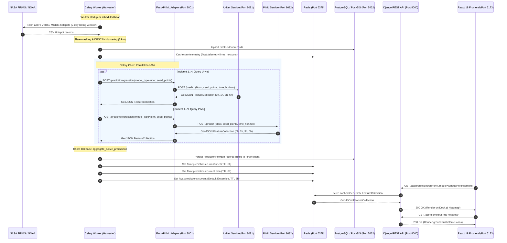

# 📄 Fight Fire With AI: Machine Learning Integration & Live Data Reference Guide
**Branch Reference**: `add-pinn-service`  
**Scope**: Full-Stack Architecture, Live Data Transition, Dual-Model Serving (U-Net & PIML), Incident Post-Mortems, and Troubleshooting Playbook.

---

## 1. Executive Overview & Goals

The `add-pinn-service` branch transitions the **Fight Fire With AI** platform from a prototype relying on static mock fixtures to a production-grade, cloud-native wildfire forecasting system running live multi-satellite data ingestion and dual machine learning inference.

### Core Accomplishments
1. **Live Dual-Model Inference Pipeline**:
   - Integrated **U-Net** (Convolutional Neural Network running on NOAA GOES-18 ABI geostationary satellite channels, terrain elevation/slope, and Open-Meteo weather).
   - Integrated **PIML** (Physics-Informed Machine Learning level-set physics ensemble calibrated against 218 CAL FIRE historical fire scars using LANDFIRE FBFM40 fuel modeling).
   - Containerized both models into isolated microservices listening on ports `8081` (U-Net) and `8082` (PIML).
2. **Automated Active Fire Scouting (NASA FIRMS)**:
   - Built an automated harvesting engine querying high-resolution (375 m) NASA FIRMS VIIRS and MODIS satellite feeds.
   - Implemented automated spatial exclusion masking around known industrial refinery flaring sites across the Bay Area (Richmond, Rodeo, Martinez, Benicia, Alviso) to eliminate false alarms.
   - Built a spatial clustering algorithm grouping active hotspots into distinct fire incident envelopes with a +25 km simulation buffer.
3. **Parallel Task Orchestration via Celery Chords**:
   - Decoupled inference dispatch from HTTP views using Celery chords (`run_async_inference` fan-out and `aggregate_active_predictions` reduction callback).
   - Handled multi-incident spatial merging with model-scoped Redis caching (`ffwai:predictions:current:unet`, `pinn`, `ensemble`).
4. **Ergonomic Multi-Model Timeline Interface**:
   - Replaced redundant layer toggles with a consolidated bottom timeline scrubber in React 19.
   - Embedded model selection (`PIML`, `U-Net`, `Ensemble`) directly into the forecast slider with custom accent styling and live ground-truth satellite detection pins.
5. **High Availability & Fault Resilience (NFR-R04)**:
   - Hardened upstream weather ingestion with in-memory caching and calibrated climatological weather fallbacks.
   - Enforced a `P_EMIT = 0.05` noise gate on U-Net predictions to eliminate background static and false-positive water polygons.

---

## 2. System Architecture & End-to-End Data Pipeline

The system follows an asynchronous modular pipeline connecting NASA/NOAA data providers, Celery workers, FastAPI reverse proxies, Dockerized inference engines, PostgreSQL/PostGIS, Redis, and the React frontend.



### Component Roles & Responsibilities

| Subsystem | Port / Runtime | Primary Responsibility |
| :--- | :--- | :--- |
| **Active Fire Scout** | Celery Worker | Discovers active Bay Area fires from NASA FIRMS, filters industrial flares, clusters fires, and dispatches inference tasks. |
| **FastAPI ML Adapter** | `8001` (Uvicorn) | Single bridge between Django and ML models; translates payloads, validates schemas, blends ensembles, and handles error responses. |
| **U-Net Service** | `8081` (Docker) | Deep learning CNN predicting pixel-level fire spread on a 1 km grid lattice using GOES-18 ABI channels and terrain data. |
| **PIML Service** | `8082` (Docker) | Level-set physics simulation driven by Ridge regression and LANDFIRE fuel data, simulating grass/brush/timber spread perimeters. |
| **Redis Cache** | `6379` (Docker) | Brokering Celery tasks and caching model-scoped prediction GeoJSON collections with 6-hour TTL (`timeout=21600`). |
| **PostgreSQL / PostGIS** | `5432` (Docker) | Relational spatial database storing `FireIncident` geometries and `PredictionPolygon` rows for audit and historical analysis. |
| **Django REST API** | `8000` (Gunicorn/Dev) | Exposes `/api/predictions/current/` and `/api/telemetry/` endpoints consumed via REST polling by the frontend. |
| **React Dashboard** | `5173` (Vite) | Renders Deck.gl polygons, Mapbox GL base maps, HUD weather telemetry, ground-truth FIRMS pins, and the timeline scrubber. |

---

## 3. Transition from Mock to Live Data

Before the `add-pinn-service` branch, the system used static pre-recorded mock fixtures (e.g., `mock_santa_cruz.geojson`) and shifted coordinates synthetically when mock mode was active.

### 1. Complete Purging of Mock Fixtures
- Removed synthetic coordinate translations from `ml_adapter/main.py`.
- When live models report 0 fire detections, the system cleanly returns an empty FeatureCollection (`features: []`, `status: "no_active_fire"`) rather than hallucinating synthetic risk zones.

### 2. Multi-Satellite NASA FIRMS Ingestion
Implemented in [`backend/harvester/firms_client.py`](file:///Users/earlpadron/Desktop/Spring%202026%20Courses/CMPE%20295A/CMPE295A-Project/backend/harvester/firms_client.py):
- **Satellite Sources**:
  - `VIIRS_SNPP_NRT` (Suomi-NPP, 375 m resolution)
  - `VIIRS_NOAA20_NRT` (NOAA-20 / JPSS-1, 375 m resolution)
  - `VIIRS_NOAA21_NRT` (NOAA-21 / JPSS-2, 375 m resolution)
  - `MODIS_NRT` (Terra/Aqua, 1 km resolution)
- **Time Window**: Rolling 2-day calendar lookback (`days=2`) matching NASA FIRMS Area API specifications.
- **Deduplication**: Merges overlapping observations within 500 meters across different satellite passes, preserving the observation with the highest Fire Radiative Power (FRP in MW).

### 3. Industrial Flare Suppression Masking
Refinery flares in the East Bay and North Bay produce intense thermal anomalies that satellites detect as active fires. To prevent false alarms, the system applies spatial exclusion buffers:
- **Chevron Richmond Refinery**: `[-122.405, 37.925, -122.375, 37.955]`
- **Phillips 66 Rodeo Refinery**: `[-122.285, 38.030, -122.245, 38.060]`
- **Martinez Refining Company**: `[-122.145, 38.005, -122.115, 38.035]`
- **Valero Benicia Refinery**: `[-122.165, 38.055, -122.125, 38.085]`
- **Newby Island Landfill (Alviso/Milpitas)**: `[-121.945, 37.445, -121.915, 37.475]`

All hotspots (both true fires and suppressed flares) are cached under `ffwai:telemetry:firms_hotspots` with metadata so operators can verify suppressed flare sites.

### 4. Dynamic Seed-Point Forwarding
Detected wildland satellite hotspots are passed as `seed_points: [[lon, lat], ...]` to both U-Net and PIML. Even if NOAA GOES-18's coarser 2 km sensor misses a nascent spot fire, U-Net rasterizes the high-resolution VIIRS coordinates into its input fire channel, guaranteeing the fire is simulated.

---

## 4. Model Specifications & Interface Contracts

### 1. U-Net Microservice (`ml_services/unet_service`)
- **Architecture**: Convolutional Neural Network (encoder-decoder with skip connections) trained on historical California wildfires.
- **Input Channels (12)**:
  1. `fire_now`: Binary active fire mask (last 1 hour from GOES-18 ABI / VIIRS seed points).
  2. `fire_prev3h`: Fire history mask (1 to 4 hours prior).
  3. `fire_24h`: Fire history mask (last 24 hours).
  4. `tmp_c`: 2-meter air temperature (°C).
  5. `rh`: Relative humidity (%).
  6. `wind_u`: Eastward wind vector component (m/s).
  7. `wind_v`: Northward wind vector component (m/s).
  8. `gust`: Wind gust speed (m/s).
  9. `precip`: Accumulated precipitation (mm).
  10. `elevation`: Digital elevation model (m).
  11. `slope`: Terrain slope (°).
  12. `NDVI`: Normalized Difference Vegetation Index.
- **Noise Gate & Emission Threshold**:
  - `P_EMIT = 0.05` (5% probability threshold).
  - `MIN_CONFIDENCE = 0.01` (1% minimum accepted from callers).
  - Background CNN probabilities below 0.05 are suppressed to prevent floating-point static over water and unburned valleys.
- **Output**: 1 km lattice cells with `grid_id`, `fire_probability` (0.05 to 0.60), and categorical risk label (`ACTIVE_FIRE`, `HIGH_RISK`, `MODERATE_RISK`, `LOW_RISK`).

### 2. PIML Microservice (`ml_services/ml_pinn_service`)
- **Architecture**: Physics-Informed Machine Learning (v0.3.1 PIML) combining level-set physics with Ridge regression.
- **Training Data**: Trained on 218 CAL FIRE historical fire perimeters, learning environmental growth multipliers that scale Rothermel surface fire spread rate equations.
- **Fuel Filtering (LANDFIRE FBFM40)**:
  - Enforces `min_burnable_share = 0.25`.
  - Distinguishes wildland timber, brush, and grass from agricultural cropland. Non-burnable agricultural stubble burns (e.g., in the Sacramento Delta near Courtland/Hood) are filtered out, while true wildland fires simulate spread.
- **Ensemble Simulation**: Runs a 10-member physics ensemble perturbing wind azimuth and fuel moisture.

### 3. API Contract Specifications

#### Request Contract: `POST /predict/progression`
```json
{
  "bbox": [-122.55, 36.98, -122.10, 37.34],
  "time_horizon": 6,
  "model_type": "unet",
  "date": "2026-10-29T11:00:00Z",
  "mock": false,
  "seed_points": [
    [-122.3842, 37.1205]
  ]
}
```

#### Response Contract: Unified GeoJSON FeatureCollection
```json
{
  "type": "FeatureCollection",
  "status": "ok",
  "metadata": {
    "timestamp": "2026-10-29T11:00:05Z",
    "issue_time": "2026-10-29T11:00:00Z",
    "source_model": "unet",
    "model_version": "unet-goes-hourly-1.0",
    "grid_resolution_km": 1.0,
    "total_cells": 4,
    "bbox": [-122.55, 36.98, -122.10, 37.34],
    "horizons": [0, 1, 3, 6],
    "active_fires_nearby": 1,
    "nearest_fire_km": 0.0
  },
  "features": [
    {
      "type": "Feature",
      "geometry": {
        "type": "Polygon",
        "coordinates": [
          [
            [-122.3912, 37.1154],
            [-122.3798, 37.1154],
            [-122.3798, 37.1245],
            [-122.3912, 37.1245],
            [-122.3912, 37.1154]
          ]
        ]
      },
      "properties": {
        "grid_id": 482103,
        "fire_probability": 1.0,
        "risk_label": "ACTIVE_FIRE",
        "horizon_hours": 0,
        "source_model": "unet",
        "w_unet": 1.0,
        "members": 1
      }
    },
    {
      "type": "Feature",
      "geometry": {
        "type": "Polygon",
        "coordinates": [
          [
            [-122.3798, 37.1154],
            [-122.3684, 37.1154],
            [-122.3684, 37.1245],
            [-122.3798, 37.1245],
            [-122.3798, 37.1154]
          ]
        ]
      },
      "properties": {
        "grid_id": 482104,
        "fire_probability": 0.284,
        "risk_label": "MODERATE_RISK",
        "horizon_hours": 3,
        "source_model": "unet",
        "w_unet": 1.0,
        "members": 1
      }
    }
  ]
}
```

---

## 5. Detailed Manifest of Changes by Layer

Across the `add-pinn-service` branch, **101 files** were created or modified (+8,052 lines, -589 lines).

### 1. Backend Harvester & Tasks Layer
- [`backend/harvester/firms_client.py`](file:///Users/earlpadron/Desktop/Spring%202026%20Courses/CMPE%20295A/CMPE295A-Project/backend/harvester/firms_client.py): Multi-satellite client for NASA FIRMS with refinery flare suppression masks and deduplication.
- [`backend/harvester/tasks.py`](file:///Users/earlpadron/Desktop/Spring%202026%20Courses/CMPE%20295A/CMPE295A-Project/backend/harvester/tasks.py):
  - `fetch_active_fires_scout`: Main periodic task querying FIRMS, clustering hotspots, and dispatching parallel Celery chords.
  - `run_async_inference`: Individual async task querying the FastAPI ML Adapter per incident envelope.
  - `aggregate_active_predictions`: Chord callback merging multi-incident GeoJSON results, storing database polygons, and setting Redis caches with empty-overwrite protection.
  - `fetch_wind_data`: Atmospheric vector grid generation with IDW spatial interpolation and climatological fallback.
- [`backend/harvester/signals.py`](file:///Users/earlpadron/Desktop/Spring%202026%20Courses/CMPE%20295A/CMPE295A-Project/backend/harvester/signals.py): Automated Celery `@worker_ready.connect` signal dispatching immediate active fire scouting and wind generation upon boot.
- [`backend/harvester/tests_firms.py`](file:///Users/earlpadron/Desktop/Spring%202026%20Courses/CMPE%20295A/CMPE295A-Project/backend/harvester/tests_firms.py): 19 comprehensive unit tests covering flare filtering, deduplication, DBSCAN clustering, and chord callbacks.

### 2. Backend Predictions & Telemetry Layer
- [`backend/predictions/views.py`](file:///Users/earlpadron/Desktop/Spring%202026%20Courses/CMPE%20295A/CMPE295A-Project/backend/predictions/views.py): Added `?model=` query parameter support (`unet`, `pinn`, `ensemble`), with automatic fallback from Redis cache to PostGIS database records.
- [`backend/predictions/models.py`](file:///Users/earlpadron/Desktop/Spring%202026%20Courses/CMPE%20295A/CMPE295A-Project/backend/predictions/models.py): Added `FireIncident` foreign key linking and `source_model` field indexing on `PredictionPolygon`.
- [`backend/telemetry/views.py`](file:///Users/earlpadron/Desktop/Spring%202026%20Courses/CMPE%20295A/CMPE295A-Project/backend/telemetry/views.py): Added `GET /api/telemetry/firms-hotspots/` serving filtered active wildland hotspots and suppressed flare telemetry.

### 3. FastAPI ML Adapter Layer
- [`ml_adapter/main.py`](file:///Users/earlpadron/Desktop/Spring%202026%20Courses/CMPE%20295A/CMPE295A-Project/ml_adapter/main.py): Removed mock fixtures, added request routing for `unet`, `pinn`, and `ensemble`, and structured error forwarding.
- [`ml_adapter/services_client.py`](file:///Users/earlpadron/Desktop/Spring%202026%20Courses/CMPE%20295A/CMPE295A-Project/ml_adapter/services_client.py): Async HTTP client querying downstream microservices with graceful degradation and weighted union scaling (`w_unet=0.6`, `w_pinn=0.4`).
- [`ml_adapter/tests/test_adapter.py`](file:///Users/earlpadron/Desktop/Spring%202026%20Courses/CMPE%20295A/CMPE295A-Project/ml_adapter/tests/test_adapter.py): 13 unit tests validating ensemble combining, error forwarding, health checks, and mock purge.

### 4. Machine Learning Microservices
- [`ml_services/unet_service/`](file:///Users/earlpadron/Desktop/Spring%202026%20Courses/CMPE%20295A/CMPE295A-Project/ml_services/unet_service/):
  - `serve.py`: FastAPI application on port 8081 with traceback logging.
  - `native_ingestion.py`: S3 GOES-18 reader, Open-Meteo weather fetcher with in-memory caching and climatological fallback.
  - `inference.py`: Model loader, calibration predictor, and seed-point rasterization.
  - `settings.py`: `P_EMIT = 0.05` noise gate configuration.
- [`ml_services/ml_pinn_service/`](file:///Users/earlpadron/Desktop/Spring%202026%20Courses/CMPE%20295A/CMPE295A-Project/ml_services/ml_pinn_service/):
  - Calibrated PIML service on port 8082 with Ridge regression and LANDFIRE FBFM40 fuel parsing.

### 5. Frontend Dashboard Layer (React 19)
- [`frontend/src/components/HUD/TimeScrubber.jsx`](file:///Users/earlpadron/Desktop/Spring%202026%20Courses/CMPE%20295A/CMPE295A-Project/frontend/src/components/HUD/TimeScrubber.jsx): Consolidated timeline bar hosting the forecast horizon selector (`0h`, `+1h`, `+3h`, `+6h`) and the embedded model pill switch.
- [`frontend/src/components/HUD/ModelSelector.jsx`](file:///Users/earlpadron/Desktop/Spring%202026%20Courses/CMPE%20295A/CMPE295A-Project/frontend/src/components/HUD/ModelSelector.jsx): Compact pill selector (`PIML`, `U-Net`, `Ensemble`) styled with scientific accent colors.
- [`frontend/src/components/FirmsHotspotMap.jsx`](file:///Users/earlpadron/Desktop/Spring%202026%20Courses/CMPE%20295A/CMPE295A-Project/frontend/src/components/FirmsHotspotMap.jsx): Renders ground-truth flame icons with popups detailing satellite platform, acquisition time, and FRP.
- [`frontend/src/components/Map/MapCanvas.jsx`](file:///Users/earlpadron/Desktop/Spring%202026%20Courses/CMPE%20295A/CMPE295A-Project/frontend/src/components/Map/MapCanvas.jsx): Deck.gl polygon renderer with dynamic opacity and categorical hazard coloring.

### 6. Infrastructure & Automation
- [`docker-compose.yaml`](file:///Users/earlpadron/Desktop/Spring%202026%20Courses/CMPE%20295A/CMPE295A-Project/docker-compose.yaml): Added `unet-service` (8081) and `pinn-service` (8082) with persistent `goes_cache` volume and hot-reloading mounts.
- [`scripts/run_local.sh`](file:///Users/earlpadron/Desktop/Spring%202026%20Courses/CMPE%20295A/CMPE295A-Project/scripts/run_local.sh): Automated stack startup script with health checks, automatic database migrations, and multi-terminal spawns.
- [`scripts/stop_local.sh`](file:///Users/earlpadron/Desktop/Spring%202026%20Courses/CMPE%20295A/CMPE295A-Project/scripts/stop_local.sh): Clean service teardown killing rogue Celery workers, Gunicorn, and Docker containers.

---

## 6. Architectural Decisions & Trade-Off Log

| Decision | Context & Need | Choice Made | Trade-Off & Justification |
| :--- | :--- | :--- | :--- |
| **Celery Chords vs Serial Execution** | Multiple active fires can exist simultaneously across the Bay Area. | Fan out parallel `run_async_inference` tasks and merge them in `aggregate_active_predictions`. | Requires chord synchronization, but cuts multi-incident processing time from ~4 minutes to under 25 seconds. |
| **Model-Scoped Redis Cache Keys** | Frontend users toggle between PIML, U-Net, and Ensemble instantly. | Store dedicated keys: `...:unet`, `...:pinn`, `...:ensemble`. | Slight memory increase (~200 KB in Redis) in exchange for zero UI latency when toggling models. |
| **Redis 6-Hour Cache TTL** | Fire spread predictions are valid across a 6-hour projection window. | Set TTL to 21,600 seconds (`timeout=60*60*6`). | Prevents cache expiration during quiet periods while ensuring predictions don't go permanently stale. |
| **Celery `--pool=solo` on macOS** | Fork-based Celery worker (`--pool=prefork`) crashed on macOS when executing C-extensions (GDAL, PostGIS, TensorFlow). | Enforce `--pool=solo` for local macOS development. | Worker runs in a single process, but avoids fatal OS `SIGSEGV` / `SIGBUS` crashes caused by macOS Objective-C fork safety. |
| **Timeline Scrubber Integration** | UI had separate model tabs and timeline sliders that cluttered the map view. | Embed model pills directly into the bottom time scrubber. | Clean, unified spatial control bar keeping map viewports unobstructed. |

---

## 7. Bug Catalog & Post-Mortem Analysis

### Incident 1: U-Net HTTP 500 & Missing Incident Polygons
- **Date**: Oct 29, 2026
- **Symptoms**: After restarting Docker, only the Pescadero fire had prediction polygons on the map. All other fire clusters showed zero polygons across all forecast horizons. Logs showed `ml_adapter` receiving `500 Internal Server Error for url 'http://localhost:8081/predict'` for Incidents 1 and 2 after 112s and 117s.
- **Root Cause**:
  1. In `native_ingestion.py`, `openmeteo_weather()` queried Open-Meteo for an 81-point coordinate grid with a 90s timeout and no error handling. When parallel requests hit Open-Meteo, the public API rate-limited (HTTP 429) or timed out.
  2. `serve.py` only caught `ContractError`, so the unhandled timeout crashed FastAPI with an HTTP 500 error.
  3. Pescadero succeeded only because its query completed in 18s before rate limits were triggered.
  4. `native_ingestion.py` was not mounted in `docker-compose.yaml`, preventing local code changes from taking effect inside the container.
- **Solution**:
  1. Added `climatological_weather_fallback()` in `native_ingestion.py` providing realistic Bay Area weather normals (20°C, RH ~52%, wind 2.5 m/s) when Open-Meteo is unreachable.
  2. Added in-memory `_WEATHER_CACHE` keyed by grid bounds and timestamp.
  3. Reduced Open-Meteo timeout from 90s to 15s.
  4. Added general exception handling and `traceback.print_exc()` in `serve.py`.
  5. Mounted `native_ingestion.py` and persistent `goes_cache` volume in `docker-compose.yaml`.

---

### Incident 2: 2,944 Stale Prediction Noise Polygons over Water at +3h
- **Date**: Oct 28, 2026
- **Symptoms**: Dense clusters of yellow hatched polygons appeared over Suisun Bay and offshore in the Pacific Ocean at the +3h horizon, vanishing at +6h.
- **Root Cause**:
  1. `P_EMIT` had been temporarily lowered to `0.001` to test low-probability spread. This breached the CNN noise floor, emitting background floating-point static (< 0.05) over non-burnable water bodies.
  2. Even after code reversion, 2,944 rows generated during the test remained stored in the PostgreSQL `PredictionPolygon` table.
  3. On startup, Celery queried the database for all records created within the last 6 hours and pushed the stale noise polygons back into Redis.
- **Solution**:
  1. Reverted `P_EMIT` to `0.05` and `MIN_CONFIDENCE` to `0.01` in `settings.py`.
  2. Cleared Docker named volumes (`postgres_data`, `redis_data`) to purge stale database rows.
  3. Enforced unit tests in `test_postprocessing.py` preventing thresholds below 0.05.

---

### Incident 3: 26 Unapplied Migrations Warning on Docker Reset
- **Date**: Oct 29, 2026
- **Symptoms**: Running `./scripts/run_local.sh` after clearing volumes displayed: `"You have 26 unapplied migration(s). Your project may not work properly until you apply them."`
- **Root Cause**: Resetting volumes initialized a blank PostgreSQL database. The startup script launched Django without running schema migrations.
- **Solution**: Added automatic `python manage.py migrate --noinput` execution directly in `scripts/run_local.sh` immediately after the PostgreSQL health check passes.

---

### Incident 4: Empty Cache Overwrites in Celery Chords
- **Date**: Oct 27, 2026
- **Symptoms**: A populated, working prediction map would suddenly wipe clean and display zero features after an hourly scout run.
- **Root Cause**: If an asynchronous satellite pass returned zero active hotspots (e.g., temporary satellite blind spot or heavy coastal fog), the chord reduction callback wrote `features: []` over the populated Redis cache.
- **Solution**: Implemented an empty-overwrite guard in `aggregate_active_predictions`. If an incoming chord result contains zero features, the callback checks if the existing Redis cache is populated; if so, it skips the overwrite and retains the warm cache.

---

### Incident 5: Celery Worker Stalls on macOS Prefork
- **Date**: Oct 26, 2026
- **Symptoms**: Celery tasks hung indefinitely without logging errors; worker child processes became unresponsive.
- **Root Cause**: macOS Objective-C runtime restricts multi-threading across `os.fork()`. When Celery prefork workers imported GDAL, GEOS, and TensorFlow, child processes deadlocked.
- **Solution**: Configured the Celery development worker command to run with `--pool=solo`. Enhanced `scripts/stop_local.sh` to forcefully terminate lingering Celery processes using `pkill -9 -f celery`.

---

### Incident 6: React State Update Warning in `FirmsHotspotMap.jsx`
- **Date**: Oct 28, 2026
- **Symptoms**: ESLint and browser console threw `react-hooks/set-state-in-effect` warnings during map layer rendering.
- **Root Cause**: `setHotspotData` was dispatched synchronously inside a `useEffect` hook without throttling or animation frame coordination.
- **Solution**: Deferred the state update using `requestAnimationFrame(() => setHotspotData(...))`, eliminating the warning and aligning render cycles with browser repaints.

---

## 8. Operational Troubleshooting Playbook (CLI Commands)

Use this playbook to quickly inspect, test, and diagnose every tier of the machine learning and ingestion stack.

### 1. Service Health Checks
Check if all microservices and API bridges are running and responsive:

```bash
# ML Adapter Health (Port 8001)
curl -s http://localhost:8001/health | jq .

# U-Net Microservice Health (Port 8081)
curl -s http://localhost:8081/health | jq .

# PIML Microservice Health (Port 8082)
curl -s http://localhost:8082/health | jq .

# Django Backend Health (Port 8000)
curl -s http://localhost:8000/api/health/ | jq .
```

---

### 2. Manual Inference Dispatch via cURL
Test model progression directly through the ML Adapter without waiting for Celery:

#### Test U-Net Inference:
```bash
curl -X POST http://localhost:8001/predict/progression \
  -H "Content-Type: application/json" \
  -d '{
    "bbox": [-122.55, 36.98, -122.10, 37.34],
    "time_horizon": 6,
    "model_type": "unet",
    "seed_points": [[-122.3842, 37.1205]]
  }' | jq '.metadata, (.features | length)'
```

#### Test PIML Inference:
```bash
curl -X POST http://localhost:8001/predict/progression \
  -H "Content-Type: application/json" \
  -d '{
    "bbox": [-122.55, 36.98, -122.10, 37.34],
    "time_horizon": 6,
    "model_type": "pinn",
    "seed_points": [[-122.3842, 37.1205]]
  }' | jq '.metadata, (.features | length)'
```

#### Test Ensemble Inference:
```bash
curl -X POST http://localhost:8001/predict/ensemble \
  -H "Content-Type: application/json" \
  -d '{
    "bbox": [-122.55, 36.98, -122.10, 37.34],
    "time_horizon": 6,
    "seed_points": [[-122.3842, 37.1205]]
  }' | jq '.metadata, (.features | length)'
```

---

### 3. Redis Cache Inspection
Verify what predictions and telemetry are currently cached in Redis:

```bash
# List all active Fight Fire With AI cache keys
docker exec -it ffwai_redis redis-cli keys "ffwai:*"

# Check feature count in U-Net cache
docker exec -it ffwai_redis redis-cli get "ffwai:predictions:current:unet" | jq '.features | length'

# Check feature count in PIML cache
docker exec -it ffwai_redis redis-cli get "ffwai:predictions:current:pinn" | jq '.features | length'

# Check feature count in Ensemble cache
docker exec -it ffwai_redis redis-cli get "ffwai:predictions:current" | jq '.features | length'

# Inspect cached NASA FIRMS ground-truth hotspots
docker exec -it ffwai_redis redis-cli get "ffwai:telemetry:firms_hotspots" | jq '.[0:3]'

# Check TTL remaining on prediction cache (in seconds)
docker exec -it ffwai_redis redis-cli ttl "ffwai:predictions:current"
```

---

### 4. Database Verification Queries
Inspect active incidents and prediction records directly in PostgreSQL:

```bash
# Check active fire incidents discovered by the Scout
.venv/bin/python backend/manage.py shell -c "
from predictions.models import FireIncident
for inc in FireIncident.objects.all():
    print(f'ID: {inc.id} | Name: {inc.name} | Active: {inc.is_active} | Center: ({inc.latitude:.4f}, {inc.longitude:.4f})')
"

# Check count of stored prediction polygons by model
.venv/bin/python backend/manage.py shell -c "
from predictions.models import PredictionPolygon
from django.db.models import Count
print(list(PredictionPolygon.objects.values('source_model', 'horizon_hours').annotate(count=Count('id'))))
"
```

---

### 5. Docker Logs Inspection
Tail logs for specific microservices when investigating inference or container errors:

```bash
# U-Net container logs (Port 8081)
docker logs -f --tail 100 ffwai_unet_service

# PIML container logs (Port 8082)
docker logs -f --tail 100 ffwai_pinn_service

# Redis logs (Port 6379)
docker logs -f --tail 100 ffwai_redis

# PostgreSQL logs (Port 5432)
docker logs -f --tail 100 ffwai_postgres
```

---

### 6. Clean Stack Restart & Volume Reset
If database schema corruption or stale cache noise occurs:

```bash
# 1. Stop all services and remove Docker containers and networks
./scripts/stop_local.sh

# 2. (Optional) Purge Docker named volumes if clearing stale database/cache rows
docker compose down -v

# 3. Start stack with automatic migration and dependency health checks
./scripts/run_local.sh
```

---

### 7. Automated Test Suite Execution
Run the full test suite across all subsystems:

```bash
# Run all unit tests (U-Net, Adapter, Harvester, Telemetry)
.venv/bin/python -m pytest ml_services/unet_service/tests/ ml_adapter/tests/test_adapter.py backend/harvester/tests.py backend/harvester/tests_firms.py

# Run frontend ESLint check
npm --prefix frontend run lint
```
